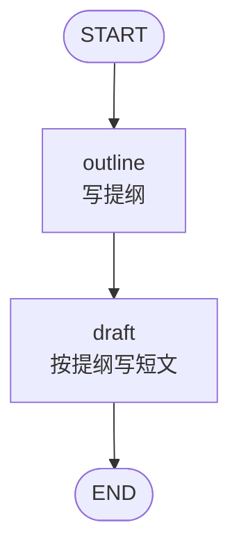
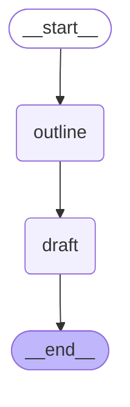
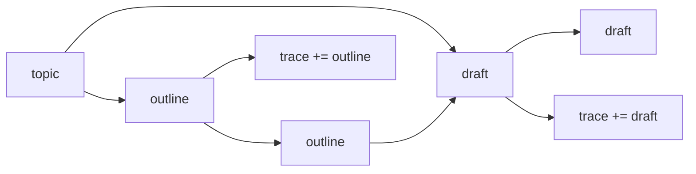

# 1_linear.py：固定边

`outline` 根据主题写提纲，`draft` 读这份提纲写成短文。两个节点之间只有一条边，每次运行都走同一条路径。

## 流程拓扑



对应的边：

```python
graph.add_edge(START, "outline")
graph.add_edge("outline", "draft")
graph.add_edge("draft", END)
```

## 库绘制的 DAG

下面是 `app.get_graph().draw_mermaid()` 的原文。`START` 显示为 `__start__`，`END` 显示为 `__end__`。



## 状态怎么流



| 节点 | 读 | 写 |
| --- | --- | --- |
| `outline` | `topic` | `outline`，并往 `trace` 追加 `"outline"` |
| `draft` | `topic`、`outline` | `draft`，并往 `trace` 追加 `"draft"` |

`invoke` 传入的初始值里，`outline` 和 `draft` 是空字符串。节点返回的字典按字段盖上去，没返回的字段保持原值。

## 一次运行

```bash
python 1_linear.py
```

```text
[outline] 写出提纲，主题是「LangGraph 的状态图」
[draft] 根据提纲写成短文
—— 最终状态 ——
主题：LangGraph 的状态图。
提纲如下：
1. LangGraph 的状态图 是什么
2. 它由哪些部分组成
3. 一个最小例子
这是一条只沿固定边往前走的流水线。
经过节点: outline -> draft
```

`trace` 的顺序就是节点执行顺序。这条图里没有选择，所以顺序始终是 `outline -> draft`。
