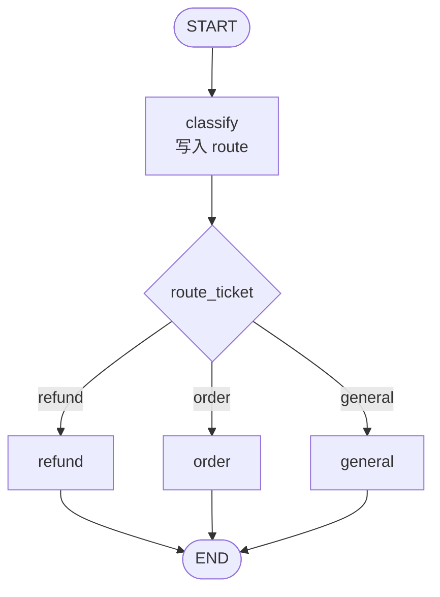
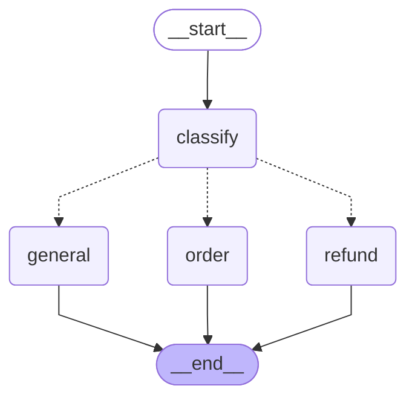

# 2_conditional.py：条件边

`classify` 读用户句子，把路由名写进 `route`。`route_ticket` 是路径函数，由 `add_conditional_edges` 登记。它返回 `"refund"`、`"order"` 或 `"general"` 之一，图进入同名节点。三条处理节点各自用固定边连到 `END`。

## 流程拓扑

菱形是路径函数，源码里没有 `add_node("route_ticket", ...)`。



对应的边：

```python
graph.add_edge(START, "classify")
graph.add_conditional_edges(
    "classify",
    route_ticket,
    {"refund": "refund", "order": "order", "general": "general"},
)
graph.add_edge("refund", END)
graph.add_edge("order", END)
graph.add_edge("general", END)
```

`path_map` 的键是路径函数的返回值，值是要进入的节点名。返回值带上 `Literal["refund", "order", "general"]` 之后，`draw_mermaid()` 只会画出这三条虚线。

分类规则在 `classify` 里：

| 句子里出现 | `route` |
| --- | --- |
| 退款、退货 | `refund` |
| 订单、物流、发货 | `order` |
| 其余 | `general` |

## 库绘制的 DAG

虚线 `-.->` 是条件边。一张图同时画出全部候选边；某一次 `invoke` 只走过其中一条。



## 三次输入各走一条边

```bash
python 2_conditional.py
```

```text
—— 输入：我要退款，衣服不合适 ——
[classify] 「我要退款，衣服不合适」 -> refund
[refund] 处理退款
经过节点: classify:refund -> refund

—— 输入：订单什么时候发货 ——
[classify] 「订单什么时候发货」 -> order
[order] 查询订单
经过节点: classify:order -> order

—— 输入：会员积分怎么用 ——
[classify] 「会员积分怎么用」 -> general
[general] 普通咨询
经过节点: classify:general -> general
```

同一次运行里，`trace` 只有 `classify` 和被选中的那个处理节点。另外两个处理函数没有被调用。
