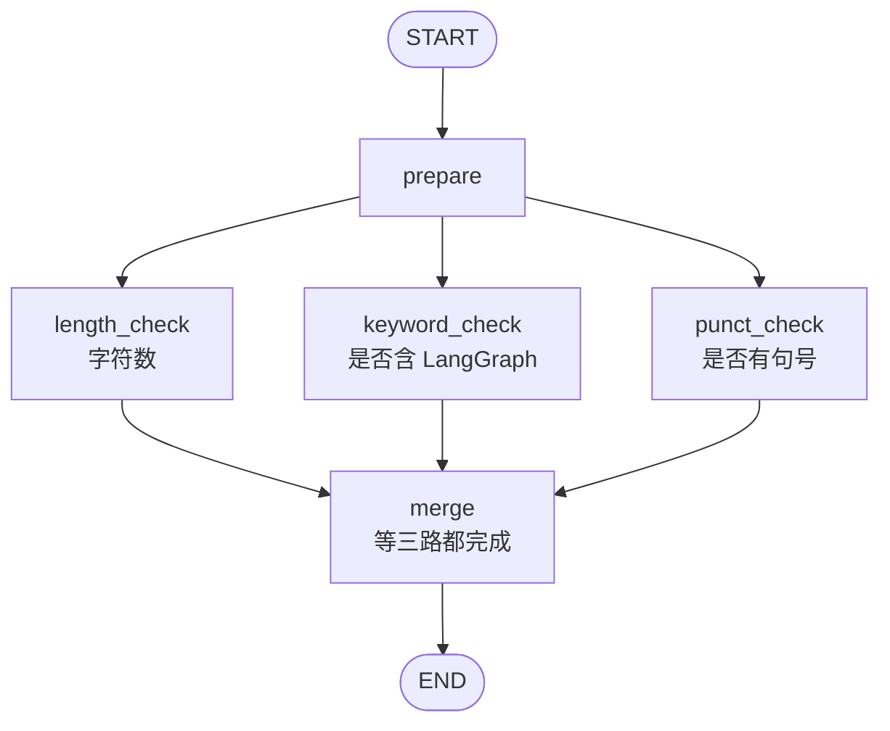
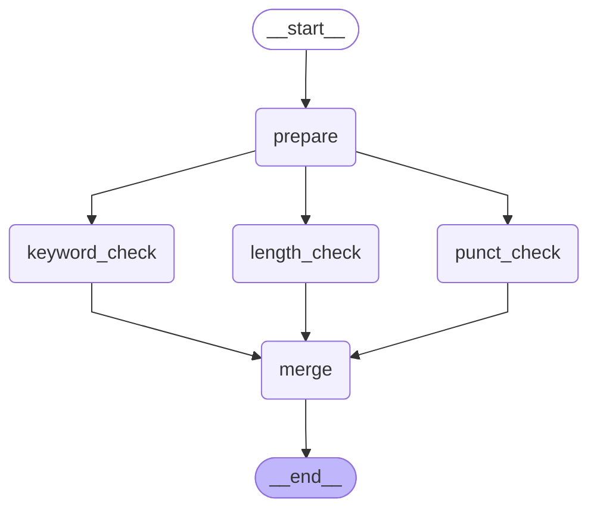
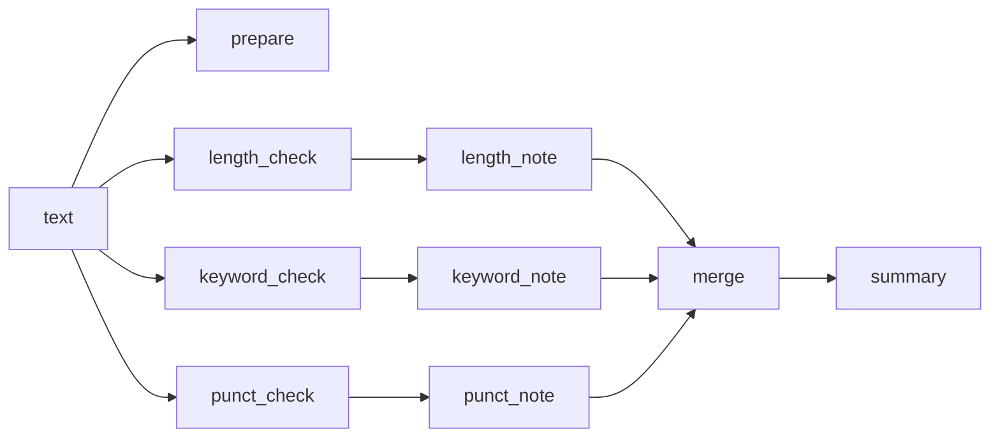

# 3_parallel.py：扇出与汇合

`prepare` 记下起始时间。它有三条出边，所以 `length_check`、`keyword_check`、`punct_check` 处于同一步，各自在线程池里跑。汇合边的起点是一个列表，`merge` 等三个节点都返回后再汇总。

## 流程拓扑



对应的边：

```python
graph.add_edge(START, "prepare")
graph.add_edge("prepare", "length_check")
graph.add_edge("prepare", "keyword_check")
graph.add_edge("prepare", "punct_check")
graph.add_edge(
    ["length_check", "keyword_check", "punct_check"],
    "merge",
)
graph.add_edge("merge", END)
```

列表形式的 `add_edge` 是等待条件：三个名字都完成后，`merge` 执行一次。

## 库绘制的 DAG

库把汇合画成三条普通箭头。等待关系写在上面的列表里，图上不再单画一个汇合符号。



## 状态字段

三路检查写不同的字段。`trace` 使用 `operator.add`，并行追加的列表会拼在一起。



| 节点 | 写 |
| --- | --- |
| `prepare` | 往 `trace` 追加 `"prepare"` |
| `length_check` | `length_note` |
| `keyword_check` | `keyword_note` |
| `punct_check` | `punct_note` |
| `merge` | `summary`，并往 `trace` 追加 `"merge"` |

每个检查节点先停 0.3 秒再返回。停顿是为了让线程池分配不同线程；三个函数本身都很短，不停的话可能挤在同一个线程上。

## 一次运行

```bash
python 3_parallel.py
```

三次检查的完成时刻都在 `prepare` 结束大约 0.3 秒之后，线程名各不相同。`trace` 里三个检查的先后跟完成顺序有关，`prepare` 一定在最前，`merge` 一定在最后。

```text
[prepare] 原文：LangGraph 用状态图描述步骤。
[punct_check] punct_check 线程=ThreadPoolExecutor-1_2 距 prepare 结束 0.305s
[length_check] length_check 线程=ThreadPoolExecutor-1_1 距 prepare 结束 0.306s
[keyword_check] keyword_check 线程=ThreadPoolExecutor-1_0 距 prepare 结束 0.306s
[merge] 三路结果都到了，开始汇总
—— 汇总 ——
length_check 线程=ThreadPoolExecutor-1_1 距 prepare 结束 0.306s；共 19 个字符
keyword_check 线程=ThreadPoolExecutor-1_0 距 prepare 结束 0.306s；包含 LangGraph
punct_check 线程=ThreadPoolExecutor-1_2 距 prepare 结束 0.305s；有句号
trace: ['prepare', 'keyword_check', 'length_check', 'punct_check', 'merge']
```
