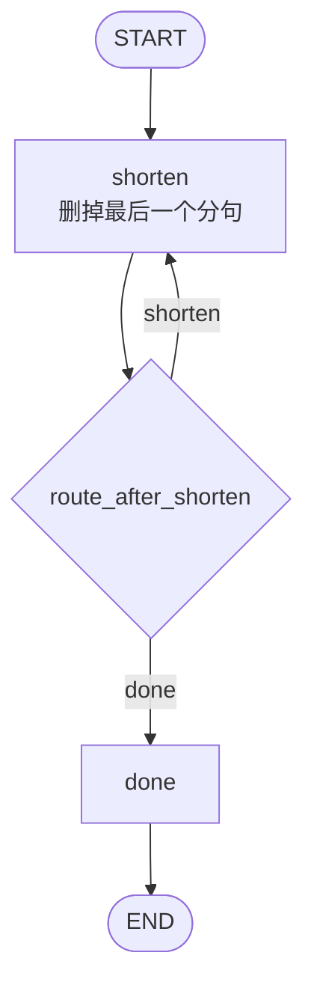
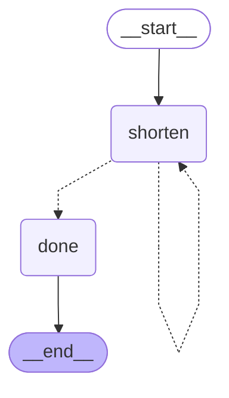
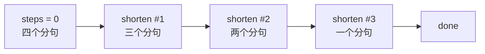

# 4_cycle.py：回到自身的条件边

`shorten` 每次删掉最后一个逗号分句。`route_after_shorten` 看当前状态：还可以继续，就返回 `"shorten"`，边回到同一个节点；该停了，就返回 `"done"`。

## 流程拓扑



对应的边：

```python
graph.add_edge(START, "shorten")
graph.add_conditional_edges(
    "shorten",
    route_after_shorten,
    {"shorten": "shorten", "done": "done"},
)
graph.add_edge("done", END)
```

回到 `shorten` 用的仍是条件边，和 `2_conditional.py` 里通向别的节点的写法相同。差别只在 `path_map` 的值是当前节点自己。

停止条件满足其一即可：

- `steps >= 3`
- 剩余分句只剩 1 个

## 库绘制的 DAG

`shorten -.-> shorten` 就是回边。虚线表示它由路径函数决定，这一轮可能走，也可能改走 `done`。



## 一轮里的状态

初始文本有四个分句：

`先读状态，再调用节点，然后按边跳转，最后写出结果`



| 次数 | 进入 `shorten` 之前 | 离开后的 `text` | 路径函数 |
| --- | --- | --- | --- |
| 1 | 四个分句，`steps = 0` | 先读状态，再调用节点，然后按边跳转 | 回到 `shorten` |
| 2 | 三个分句，`steps = 1` | 先读状态，再调用节点 | 回到 `shorten` |
| 3 | 两个分句，`steps = 2` | 先读状态 | 去 `done`（`steps` 达到 3，分句也只剩一个） |

`steps` 由节点读旧值再写回 `旧值 + 1`。这个字段每次只有 `shorten` 在写，所以直接覆盖即可。

## 一次运行

```bash
python 4_cycle.py
```

```text
[shorten] 第 1 次 -> 先读状态，再调用节点，然后按边跳转
[shorten] 第 2 次 -> 先读状态，再调用节点
[shorten] 第 3 次 -> 先读状态
[done] 停止，共缩短 3 次，剩余「先读状态」
—— 最终状态 ——
text: 先读状态
steps: 3
经过节点: shorten#1 -> shorten#2 -> shorten#3 -> done
```

`trace` 里同一个节点名出现三次，对应图上那条回边被走了两次，第三次改走 `done`。
