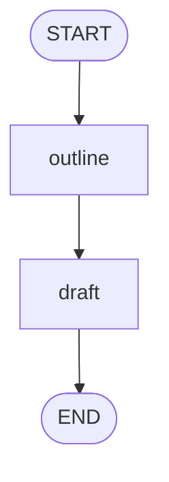
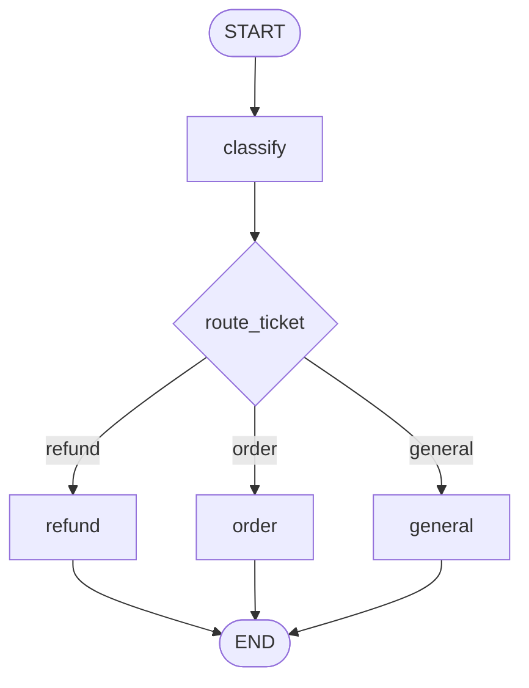
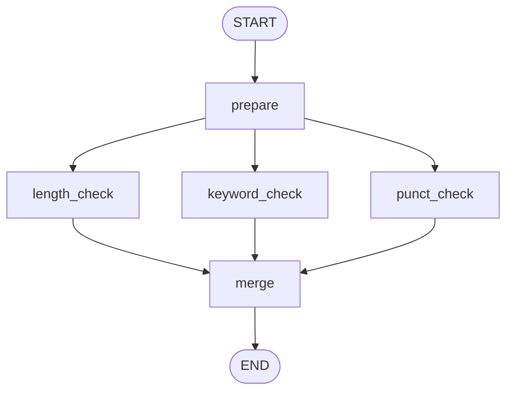
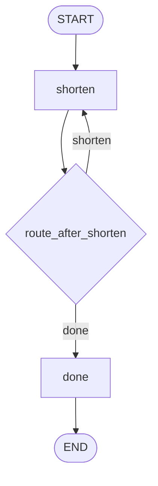

# LangGraph 四种基本图

学习 LangGraph 时做的四个最小例子：线性、条件、并行、循环。
每个脚本几十行，只有本地函数，不调任何模型——专心看图本身怎么跑。

这组例子只需要 Python 3.10+ 和 langgraph 1.0。四个脚本都是本地函数，状态在节点之间传递，用来看 DAG 本身。

阅读顺序按编号来。每份说明里有两张 Mermaid 图：第一张按步骤标注，第二张是该脚本里 `get_graph().draw_mermaid()` 的原文，和终端打印的一致。

| 编号 | 脚本 | 形状 | 对应说明 |
| --- | --- | --- | --- |
| 1 | `1_linear.py` | 固定边，一条直线 | [1_linear.md](1_linear.md) |
| 2 | `2_conditional.py` | 条件边，三选一 | [2_conditional.md](2_conditional.md) |
| 3 | `3_parallel.py` | 扇出，再汇合 | [3_parallel.md](3_parallel.md) |
| 4 | `4_cycle.py` | 条件边回到自身 | [4_cycle.md](4_cycle.md) |

## 怎么运行

```bash
cd langgraph-basics
python 1_linear.py
python 2_conditional.py
python 3_parallel.py
python 4_cycle.py
```

脚本先打印 Mermaid，再 `invoke` 一次并打印最终状态。

## 四张图放在一起

库生成的图里，`__start__` 和 `__end__` 就是代码中的 `START`、`END`。实线 `-->` 是 `add_edge`。虚线 `-.->` 是 `add_conditional_edges`。









## 四个脚本共用的写法

状态是一个 `TypedDict`。节点函数接收当前状态，返回要合并进去的字段。`trace` 写成 `Annotated[list[str], operator.add]`，节点每次返回一段列表，框架把它接在已有记录后面。

图在 `build_graph()` 里声明，`compile()` 之后才能 `invoke`。`START` 和 `END` 从 `langgraph.graph` 导入，声明边时使用，它们本身没有对应的 Python 函数。
